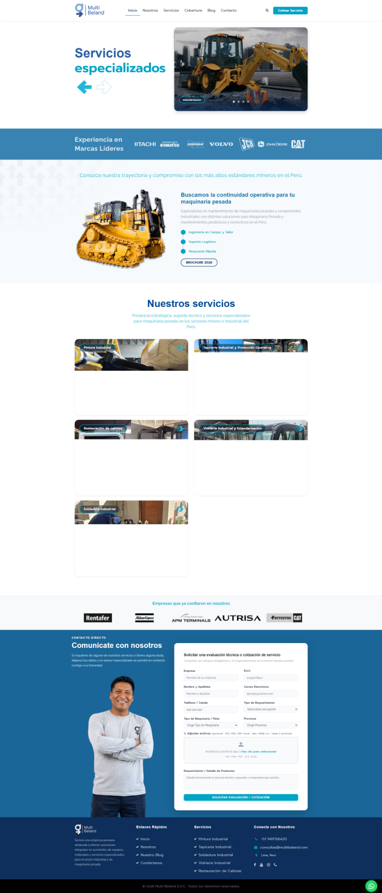
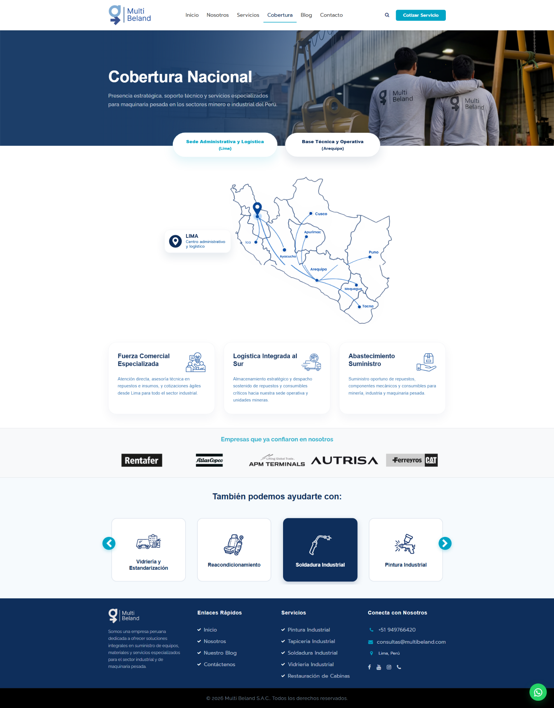
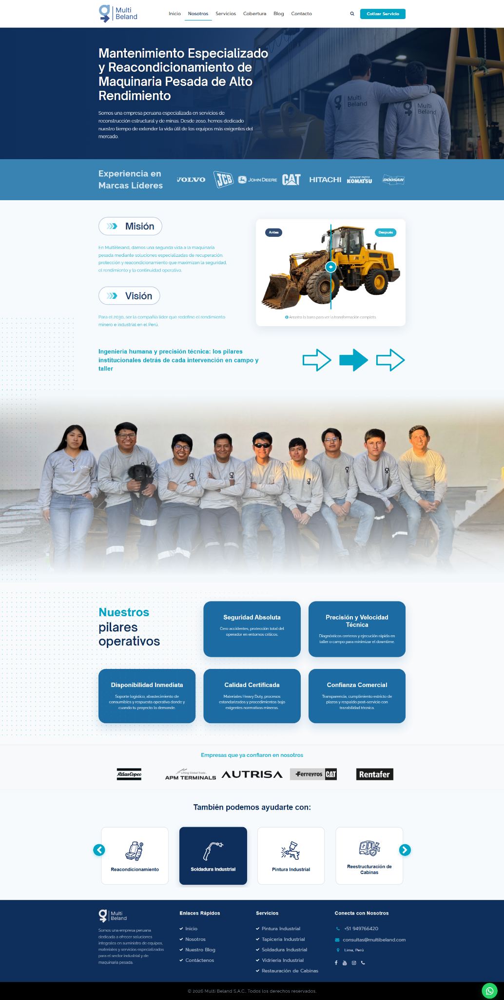
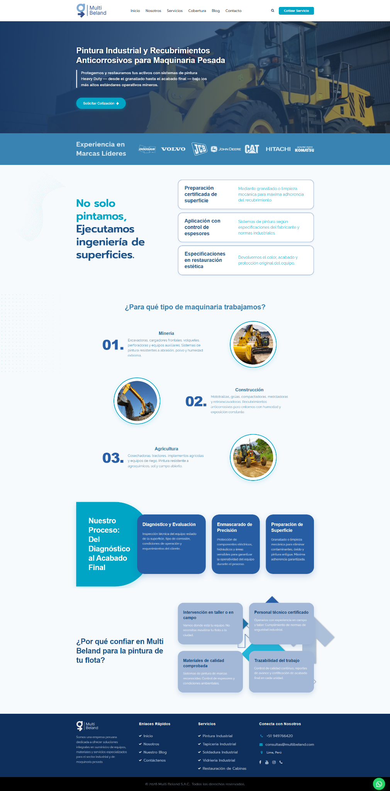
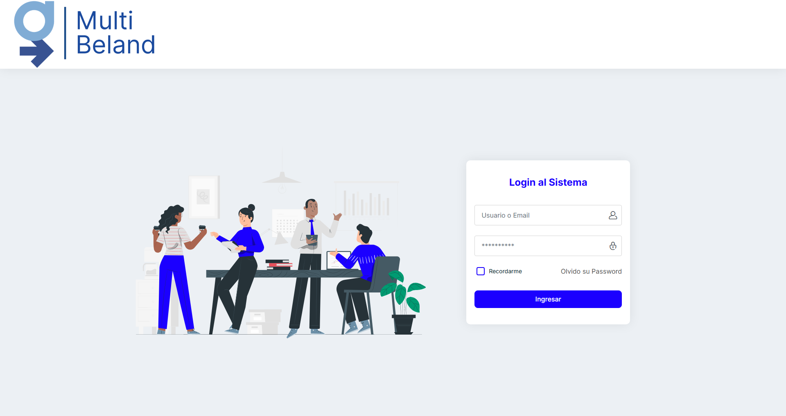
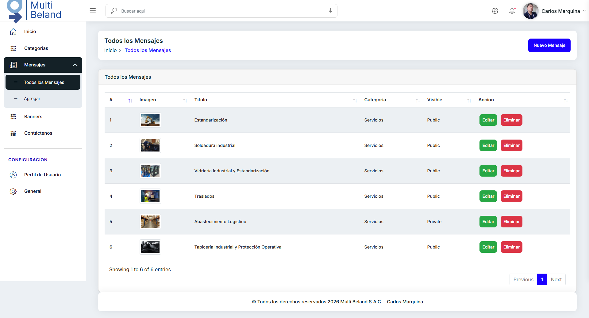
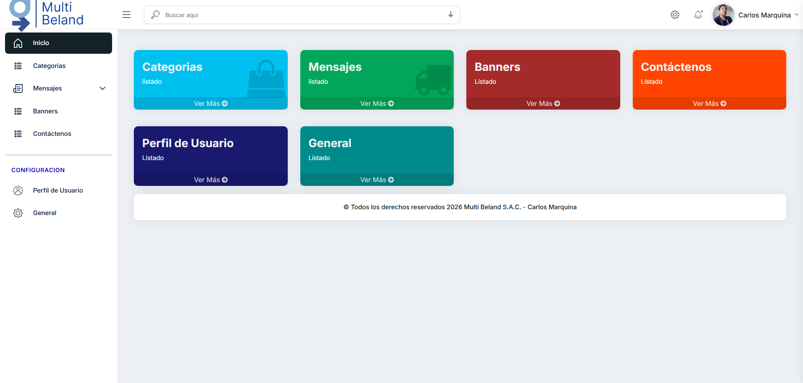
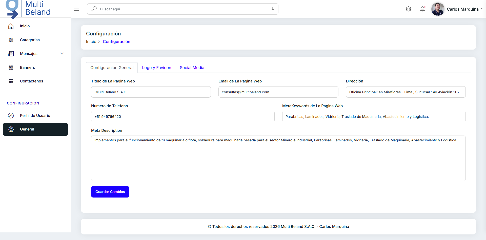

# MULTIBELAND-CODEIGNITER4

<p align="center">
  <strong>Plataforma web corporativa y sistema de administración desarrollado con CodeIgniter 4</strong>
</p>

<p align="center">
  
</p>

<p align="center">
  
  
  
  
  
</p>

---

## 📌 Descripción

**Multi Beland** es una plataforma web corporativa desarrollada utilizando PHP y el framework CodeIgniter 4.

El proyecto está orientado a presentar los servicios especializados de Multi Beland S.A.C., empresa dedicada a ofrecer soluciones relacionadas con maquinaria pesada, mantenimiento industrial, abastecimiento, logística y servicios técnicos especializados.

La plataforma integra un sitio web público y un sistema de administración que permite gestionar diferentes contenidos y configuraciones del sitio.

El desarrollo utiliza una arquitectura basada en el framework CodeIgniter 4, separando la lógica de aplicación, las vistas, las rutas, los recursos públicos y los componentes del sistema.

---

## 🎯 Objetivos del proyecto

- Desarrollar una plataforma web corporativa para la presentación de servicios empresariales.
- Centralizar la administración de contenidos del sitio web.
- Facilitar la gestión de mensajes y categorías.
- Administrar banners y elementos visuales.
- Gestionar configuraciones generales del sitio web.
- Facilitar la actualización de contenidos sin modificar directamente el código fuente.
- Mantener una estructura organizada y escalable utilizando CodeIgniter 4.

---

## 🚀 Características principales

### 🌐 Frontend corporativo

- Página principal.
- Presentación institucional.
- Información de misión y visión.
- Presentación de servicios especializados.
- Cobertura nacional.
- Secciones informativas.
- Formulario de contacto y cotización.
- Navegación entre páginas.
- Diseño adaptable a diferentes dispositivos.

### ⚙️ Panel administrativo

- Sistema de autenticación.
- Dashboard administrativo.
- Gestión de categorías.
- Gestión de mensajes y contenidos.
- Gestión de banners.
- Administración de contactos.
- Gestión del perfil de usuario.
- Configuración general del sitio.
- Administración del logo y favicon.
- Configuración de redes sociales.
- Gestión de información institucional.

---

## 🖥️ Capturas de pantalla

### Frontend - Sitio web corporativo

#### Página principal y servicios

<p align="center">
  
</p>

#### Cobertura nacional

<p align="center">
  
</p>

#### Nosotros - Misión y visión

<p align="center">
  
</p>

#### Pintura industrial

<p align="center">
  
</p>

---

### Backend - Panel administrativo

#### Inicio de sesión

<p align="center">
  
</p>

#### Gestión de mensajes

<p align="center">
  
</p>

#### Dashboard administrativo

<p align="center">
  
</p>

#### Configuración general

<p align="center">
  
</p>

---

## 🛠️ Tecnologías utilizadas

| Tecnología | Descripción |
|---|---|
| PHP | Lenguaje de programación backend |
| CodeIgniter 4 | Framework PHP |
| MySQL / MariaDB | Sistema de gestión de base de datos |
| Composer | Administración de dependencias PHP |
| Apache | Servidor web |
| HTML5 | Estructura del frontend |
| CSS3 | Diseño y estilos |
| JavaScript | Interactividad del frontend |
| Bootstrap | Componentes y diseño responsive |
| Git | Control de versiones |
| GitHub | Repositorio de código |

---

## 📁 Estructura del proyecto

```text
MULTIBELAND-CODEIGNITER4/
│
├── app/
│   ├── Config/
│   ├── Controllers/
│   ├── Models/
│   ├── Views/
│   └── ...
│
├── assets/
│   └── screenshots/
│       ├── inicio.png
│       ├── cobertura.png
│       ├── nosotros.png
│       ├── pintura-industrial.png
│       ├── login.png
│       ├── admin-mensajes.png
│       ├── admin-dashboard.png
│       └── admin-configuracion.png
│
├── public/
│   ├── index.php
│   ├── assets/
│   └── ...
│
├── system/
├── tests/
├── writable/
│
├── .gitignore
├── .htaccess
├── composer.json
├── composer.lock
├── preload.php
├── phpunit.xml.dist
├── README.md
└── spark
```

### Directorios principales

| Directorio | Descripción |
|---|---|
| `app/` | Código principal de la aplicación |
| `app/Controllers/` | Controladores de la aplicación |
| `app/Models/` | Modelos y acceso a datos |
| `app/Views/` | Vistas del frontend y administración |
| `app/Config/` | Configuración del framework |
| `public/` | Directorio público de acceso web |
| `system/` | Núcleo del framework CodeIgniter 4 |
| `tests/` | Pruebas de la aplicación |
| `writable/` | Logs, caché y archivos temporales |
| `assets/screenshots/` | Capturas de pantalla de la documentación |

---

## 💻 Requisitos

Para ejecutar el proyecto en un entorno local se recomienda contar con:

- PHP compatible con la versión de CodeIgniter 4 utilizada.
- Apache.
- MySQL o MariaDB.
- Composer.
- Git.
- XAMPP para el entorno de desarrollo local.

Las extensiones PHP requeridas dependerán de la versión del framework y de las dependencias instaladas.

---

## ⚙️ Instalación local

### 1. Clonar el repositorio

Desde una terminal, ingresar al directorio de proyectos de XAMPP:

```bash
cd C:\xampp\htdocs
```

Clonar el repositorio:

```bash
git clone https://github.com/karlosystem/MULTIBELAND-CODEIGNITER4.git
```

Ingresar al proyecto:

```bash
cd MULTIBELAND-CODEIGNITER4
```

---

### 2. Instalar dependencias

Ejecutar Composer:

```bash
composer install
```

Este comando instalará las dependencias definidas en `composer.json` y `composer.lock`.

---

### 3. Configurar el entorno

Copiar el archivo de configuración de entorno:

```bash
copy env .env
```

Si el archivo `env` no se encuentra disponible en el repositorio, utilizar la plantilla de configuración correspondiente a la versión de CodeIgniter 4 instalada.

Editar el archivo `.env` y configurar los parámetros del entorno local.

Ejemplo:

```ini
CI_ENVIRONMENT = development
```

Configurar también la URL base de la aplicación según el entorno local.

Ejemplo:

```ini
app.baseURL = 'http://localhost/MULTIBELAND-CODEIGNITER4/public/'
```

La URL deberá ajustarse según la configuración del servidor Apache.

---

### 4. Configurar la base de datos

Crear la base de datos correspondiente en MySQL o MariaDB.

Configurar las credenciales en el archivo `.env`.

Ejemplo:

```ini
database.default.hostname = localhost
database.default.database = nombre_base_datos
database.default.username = root
database.default.password =
database.default.DBDriver = MySQLi
database.default.port = 3306
```

Reemplazar los valores de configuración por los correspondientes al entorno local.

---

### 5. Configurar permisos

El directorio `writable/` debe permitir que CodeIgniter pueda escribir archivos de:

- Logs.
- Caché.
- Archivos temporales.
- Otros recursos generados por la aplicación.

En Windows utilizando XAMPP, verificar que el directorio tenga los permisos necesarios.

---

### 6. Ejecutar el proyecto

Con Apache iniciado desde XAMPP, acceder a:

```text
http://localhost/MULTIBELAND-CODEIGNITER4/public/
```

También es posible utilizar el servidor de desarrollo de CodeIgniter:

```bash
php spark serve
```

Por defecto, el servidor de desarrollo permite acceder mediante:

```text
http://localhost:8080
```

---

## 🧰 Comandos útiles

| Comando | Descripción |
|---|---|
| `composer install` | Instala las dependencias |
| `php spark serve` | Inicia el servidor de desarrollo |
| `php spark` | Consulta los comandos disponibles |
| `php spark routes` | Consulta las rutas registradas |
| `php spark migrate` | Ejecuta migraciones configuradas |
| `php spark cache:clear` | Limpia la caché del framework |

La disponibilidad de determinados comandos dependerá de la configuración y funcionalidades implementadas en el proyecto.

---

## 🔐 Seguridad

El repositorio debe mantener fuera del control de versiones los archivos y configuraciones sensibles del entorno de desarrollo y producción.

Se recomienda:

- No publicar credenciales de bases de datos.
- No publicar contraseñas.
- Mantener el archivo `.env` fuera del repositorio.
- No versionar logs ni archivos temporales.
- Mantener las dependencias actualizadas.
- Configurar correctamente los permisos del directorio `writable/`.
- Utilizar HTTPS en entornos de producción.
- Mantener el directorio `public/` como punto de acceso web.
- Revisar las configuraciones de Apache y PHP para producción.

---

## 🧩 Desarrollo

Este proyecto utiliza CodeIgniter 4 como framework principal para el desarrollo de la aplicación web.

La arquitectura permite organizar las funcionalidades mediante controladores, modelos, vistas, configuraciones y rutas.

El sistema puede ampliarse mediante nuevas funcionalidades, módulos y componentes de acuerdo con las necesidades de la empresa.

---

## 📌 Estado del proyecto

<kbd>Desarrollo y mantenimiento</kbd>

El proyecto se encuentra sujeto a mejoras, actualizaciones y ampliaciones funcionales.

---

## 👨‍💻 Autor

**Carlos Alberto Marquina Chuquihuaccha**

- GitHub: [@karlosystem](https://github.com/karlosystem)

---

<p align="center">
  <strong>Proyecto desarrollado con PHP y CodeIgniter 4.</strong>
</p>

<p align="center">
  Multi Beland S.A.C.
</p>
